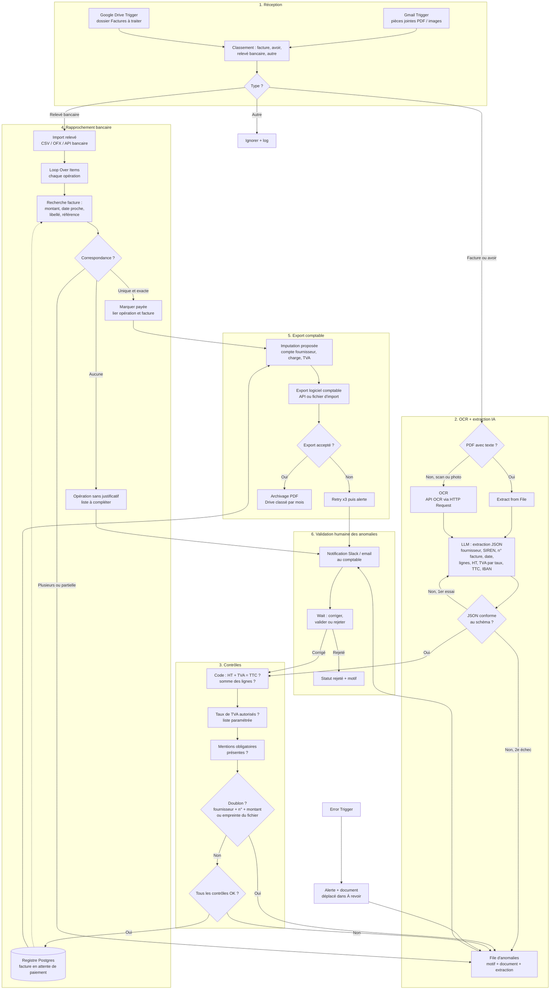

# Traitement automatique des factures et relevés comptables (n8n)

## Objectif
Ne plus saisir les factures à la main. Les factures fournisseurs et les relevés bancaires arrivent par email ou dans un dossier Drive ; n8n les lit (OCR + extraction IA), vérifie les montants et la TVA, détecte les doublons, rapproche chaque facture de son paiement et exporte le tout vers le logiciel comptable. **Seules les anomalies demandent une intervention humaine.**

## Schéma

## Explication étape par étape

1. **Réception** : un `Gmail Trigger` récupère les pièces jointes des emails reçus sur une adresse dédiée (par exemple `factures@…`) ; un `Google Drive Trigger` surveille un dossier « Factures à traiter » où l'on dépose les scans.
2. **Classement** : un `Text Classifier` distingue facture, avoir, relevé bancaire et document hors sujet.
3. **Lecture du document** : si le PDF contient du texte, `Extract from File` suffit. S'il s'agit d'un scan ou d'une photo, on passe par un service OCR appelé en `HTTP Request` (au choix : OCR cloud, modèle vision, outil auto-hébergé).
4. **Extraction IA en JSON** : un `Information Extractor` (ou LLM + `Structured Output Parser`) produit un JSON strict : fournisseur, SIREN/SIRET, numéro et date de facture, lignes, total HT, TVA par taux, TTC, échéance, IBAN. En cas de JSON invalide, un second essai est tenté, puis la facture part en anomalie.
5. **Contrôles arithmétiques** : un nœud `Code` vérifie que HT + TVA = TTC et que la somme des lignes correspond au total, avec une tolérance d'arrondi de quelques centimes à paramétrer.
6. **Contrôle de la TVA** : les taux détectés sont comparés à une liste autorisée. En France métropolitaine, les taux courants sont 20 %, 10 %, 5,5 % et 2,1 % ; **cette liste et les cas particuliers (autoliquidation, intracommunautaire, franchise) sont à faire valider par l'expert-comptable** avant mise en production.
7. **Mentions obligatoires** : présence du numéro de facture, de la date, de l'identité du fournisseur et des montants. La liste exacte est à définir avec le comptable.
8. **Doublons** : on cherche une facture existante avec le même fournisseur, le même numéro et le même montant, et on compare aussi l'empreinte du fichier (nœud `Crypto`). Un doublon n'est jamais exporté.
9. **Registre** : les factures valides sont enregistrées dans Postgres avec le statut « en attente de paiement ».
10. **Rapprochement bancaire** : le relevé (CSV, OFX ou API bancaire) est importé, puis chaque opération (`Loop Over Items`) est comparée aux factures en attente : montant, date proche, libellé et référence. Une correspondance unique et exacte marque la facture comme payée ; une correspondance multiple ou partielle part en anomalie ; une opération sans facture rejoint la liste des justificatifs manquants.
11. **Imputation et export** : n8n propose le compte fournisseur, le compte de charge et le compte de TVA (règles par fournisseur), puis exporte vers le logiciel comptable : nœud natif s'il existe (`QuickBooks Online`, `Xero`), sinon API via `HTTP Request` ou fichier d'import CSV.
12. **Archivage** : le PDF est renommé (date, fournisseur, numéro) et classé par mois dans Drive.
13. **Validation humaine des anomalies** : chaque anomalie arrive au comptable avec le motif, le document et l'extraction. Il corrige (le dossier repasse dans les contrôles), valide ou rejette, via un formulaire et un nœud `Wait`.
14. **Gestion d'erreurs** : un `Error Trigger` alerte l'équipe et déplace le document dans un dossier « À revoir » pour qu'aucune pièce ne se perde.

## Nœuds n8n principaux
`Gmail Trigger` / `Google Drive Trigger` → `Text Classifier` → `IF` → `Extract from File` / `HTTP Request` (OCR) → `Information Extractor` + `Structured Output Parser` → `Code` (contrôles HT/TVA/TTC) → `Crypto` (empreinte) → `Postgres` (registre, doublons) → `Loop Over Items` → `Merge` / `Compare Datasets` (rapprochement) → `QuickBooks Online` / `Xero` / `HTTP Request` → `Google Drive` (archivage) → `Slack` + `n8n Form` + `Wait` (anomalies) ; `Error Trigger` → `Slack`.

## Garde-fous
- **L'IA extrait, les règles décident** : tous les calculs et contrôles sont faits en code, pas par le LLM.
- **Validation humaine** : toute anomalie (écart de montant, TVA inhabituelle, doublon possible, rapprochement ambigu, nouveau fournisseur, changement d'IBAN) est revue par une personne. Au démarrage, faire valider aussi un échantillon de factures « OK ».
- **Fraude** : un changement d'IBAN chez un fournisseur connu bloque toujours la facture jusqu'à vérification humaine par un autre canal.
- **Aucun paiement automatique** : le workflow prépare et rapproche, il ne déclenche jamais de virement.
- **RGPD et conservation** : les factures contiennent des données personnelles (noms, adresses, IBAN) ; accès restreint, durée de conservation conforme aux obligations comptables à confirmer avec le comptable, choix d'un fournisseur OCR/LLM compatible avec ces données.
- **Coûts** : OCR seulement pour les scans, modèle léger pour le classement, traitement par lots.
- **Sécurité** : adresse de réception dédiée, pièces jointes limitées aux PDF et images, credentials stockés dans n8n, journal d'audit de chaque modification.
